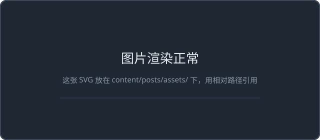

这篇是脚手架自带的示例，用来确认各类内容都能正常渲染。确认完可以删掉，换成自己的第一篇文章。

## 公式

行内写成 $f_r(\omega_i, \omega_o)$ 这样。行间公式单独一段：

$$
L_o(p, \omega_o) = \int_{\Omega} f_r(p, \omega_i, \omega_o)\, L_i(p, \omega_i)\, (\omega_i \cdot n)\, \mathrm{d}\omega_i
$$

## 代码

HLSL 片段也会按 C 的语法着色：

```hlsl
float3 SchlickFresnel(float3 F0, float cosTheta)
{
    return F0 + (1.0 - F0) * pow(1.0 - cosTheta, 5.0);
}

[numthreads(64, 1, 1)]
void CSMain(uint3 id : SV_DispatchThreadID)
{
    RWTexture2D<float4> outTex = ResourceDescriptorHeap[id.x];
    outTex[id.xy] = float4(SchlickFresnel(float3(0.04, 0.04, 0.04), 0.5), 1.0);
}
```

## 图片

相对路径引用，文件放在同级 `assets/` 目录下：



## 流程图

````markdown

````

实际效果：


## 提示块

> [!note]
> 这种 callout 在 Typora 里用「引用 + 方括号类型」也能写出来。

> [!warning]
> 图片别用绝对路径，Typora 偏好设置里要选「复制图片到 ./assets/」并勾上「优先使用相对路径」。

## 表格

| 项目 | 值 |
|---|---|
| 引擎 | Quartz 5 |
| 写作 | Typora |
| 部署 | Cloudflare Pages |

---

以上都正常显示的话，说明这套脚手架可以直接用了。
